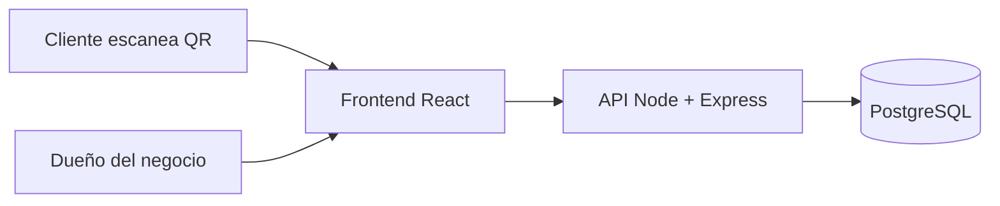
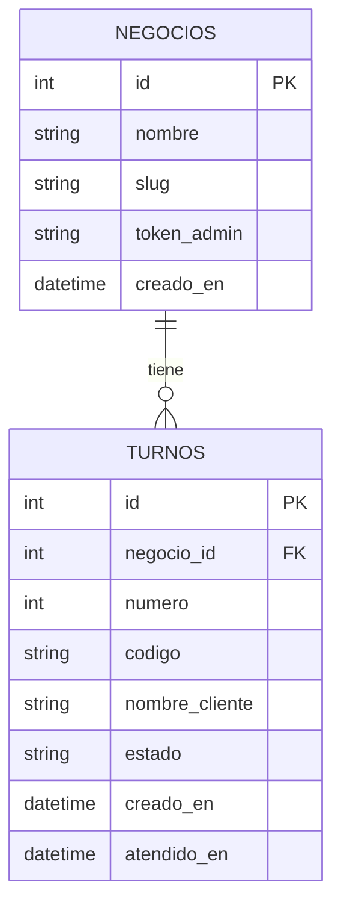

# Turnos QR

Sistema de turnos con código QR para negocios pequeños (sodas, barberías, clínicas), que evita filas desordenadas y le permite al cliente saber cuánto le falta.

> Estado: en desarrollo.

## Demo
*(pendiente: enlace y capturas de pantalla)*

## El problema
En muchos negocios pequeños los turnos se manejan "a ojo". Esto genera confusión sobre el orden y obliga al cliente a quedarse esperando sin saber cuánto falta.

## Qué hace
- El cliente escanea un QR y toma su turno desde el celular, sin instalar nada.
- Ve cuántas personas hay antes que él, y la pantalla se actualiza sola.
- El dueño del negocio ve la fila en un panel y avanza con el botón "Siguiente".

## Tecnologías y por qué
| Parte | Tecnología | Por qué |
|---|---|---|
| Frontend | React + Vite + Tailwind CSS | Muy usado en el mercado y rápido de desarrollar |
| Backend | Node.js + Express + TypeScript | Mismo lenguaje que el frontend; TypeScript evita errores |
| Base de datos | PostgreSQL | Relacional, gratuita y muy demandada |
| Contenedores | Docker | Que funcione igual en cualquier computadora |
| Despliegue | *(pendiente)* | |

## Arquitectura

## Modelo de datos


- Un negocio tiene muchos turnos; cada turno pertenece a un solo negocio.
- La pareja (`negocio_id`, `numero`) es única, para que no se repitan números dentro de un negocio.
- Estados de un turno: `esperando`, `atendiendo`, `terminado`, `cancelado`.
- `codigo` es un código privado del cliente, necesario para cancelar su propio turno.
- La posición en la fila no se guarda: se calcula contando los turnos `esperando` con número menor.

## Estructura del proyecto
Estructura planeada, se irá creando paso a paso:
```
turnos-qr/
├── backend/    # API y lógica del servidor
├── frontend/   # Interfaz web (cliente y panel)
├── docs/       # Diagramas y documentación
└── README.md
```

## Cómo correrlo en local
*(pendiente: requisitos, instalación y comandos)*

## Pruebas
*(pendiente)*

## Despliegue
*(pendiente)*

## Decisiones técnicas
*(pendiente: iré anotando aquí por qué elegí cada cosa)*

## Mejoras futuras
- Notificación cuando falten pocos turnos
- Soporte para varios negocios con su propia cuenta
- Tiempo estimado de espera
- Ver el menú o los servicios del negocio mientras se espera
- Aviso cuando falten pocos turnos
- Cuentas con inicio de sesión para los dueños
