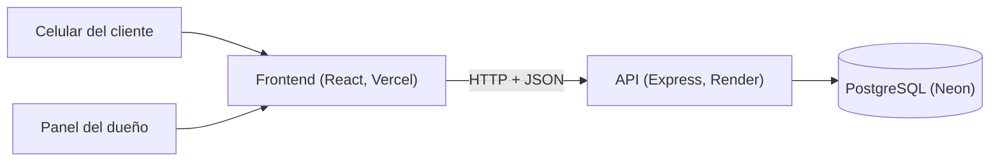
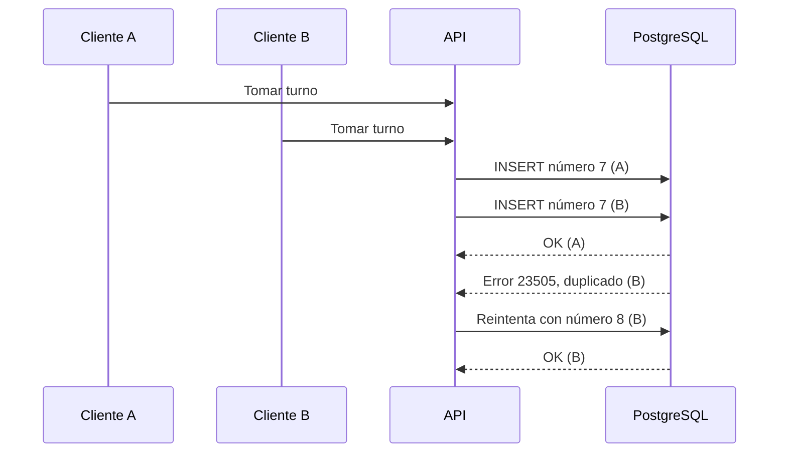
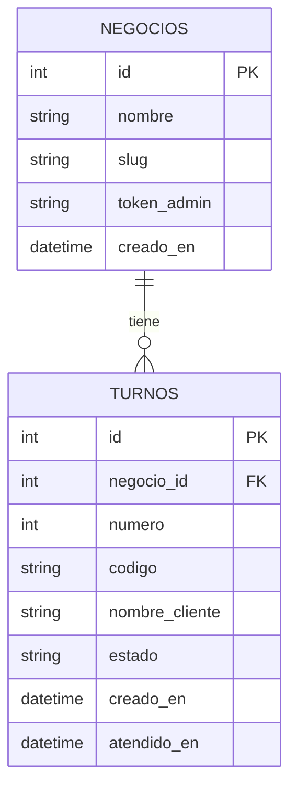

# Turnos QR

Una fila virtual para negocios pequeños. La idea es sencilla: el negocio pega un código QR en la pared, el cliente lo escanea con su celular, toma su turno y desde ahí ve cuántas personas tiene delante, sin instalar nada. Del otro lado, el dueño maneja la fila desde un panel y avanza con un solo botón.

**Demo:** https://turnos-qr.vercel.app

## Está publicado y funcionando

Todo el proyecto está desplegado en servicios con plan gratuito, así que se puede probar sin instalar nada. El frontend vive en Vercel, la API en Render y la base de datos en Neon.

Por ser planes gratuitos hay un detalle que conviene saber: el servidor de Render se duerme cuando pasa unos 15 minutos sin recibir visitas, y la primera petición después de eso tarda cerca de un minuto en despertarlo. Si la demo parece lenta al entrar, es por eso y no porque esté caída; después de ese primer momento responde con normalidad.

Para que nadie piense que se rompió, la interfaz muestra un aviso cuando una petición tarda más de 4 segundos.

## Por qué lo hice

Quería un proyecto pequeño que pasara por todas las capas de un trabajo real: base de datos, API, interfaz, control de acceso y despliegue. Elegí un problema de todos los días, el de esperar turno en una soda, una barbería o una clínica, donde el orden casi siempre se resuelve "a ojo" y nadie sabe cuánto falta.

## Probarlo en dos minutos

1. Entra a la demo y crea un negocio. Guarda el código de administrador que aparece: no se vuelve a mostrar y no hay forma de recuperarlo. El QR, en cambio, puedes volver a abrirlo y descargarlo cuando quieras desde el panel.
2. Escanea el QR con tu celular y toma un turno.
3. En el panel, presiona **Siguiente** y mira cómo cambia la pantalla del celular en unos segundos.

## Cómo está armado



Cada negocio tiene su propia dirección (`/n/nombre-del-negocio`), que es la que lleva el QR. Cuando un cliente toma un turno recibe un código privado que queda en su dirección (`/turno/<código>`), y desde ahí ve su posición y puede cancelar. La pantalla se actualiza sola cada 5 segundos.

## Decisiones técnicas

**Los números de turno los protege la base de datos, no el código.** El siguiente número se calcula como el mayor del negocio más uno, pero si dos clientes piden turno al mismo tiempo, los dos calculan el mismo. Para que eso no genere turnos repetidos, la tabla tiene una restricción `UNIQUE (negocio_id, numero)`: solo uno de los dos entra, y el otro recibe un error de clave duplicada. En ese caso la API reintenta con el número siguiente, hasta 5 veces. La garantía no depende de que mi código sea perfecto, sino de una regla que la base de datos hace cumplir.

**Los límites de peticiones solo cubren lo que escribe.** Crear negocios (5 por hora), pedir turnos (30 cada 10 minutos) y los intentos fallidos con el código del dueño (10 cada 15 minutos) tienen límite por IP. Las consultas de lectura, como las que hace la pantalla cada 5 segundos, no lo tienen a propósito: los clientes de un mismo negocio suelen compartir Wi-Fi y, por lo tanto, IP, así que un límite general bloquearía a gente legítima. Como la API corre detrás del proxy de Render, usa `trust proxy` para leer la IP real de cada cliente.

**La interfaz parte de una idea: el turno es un boleto.** Fondo de papel cálido, texto en tinta oscura y un solo acento terracota apagado, con Fraunces para los títulos y DM Mono para los números, como en las máquinas de turnos. Los colores y las fuentes se definen una sola vez en el tema de Tailwind, así que cambiar la paleta toca un único archivo. Las fuentes se sirven desde el propio sitio con Fontsource, sin depender de un servicio externo. El panel del dueño aprovecha el ancho de la pantalla porque se usa en una computadora o tablet detrás del mostrador; las pantallas del cliente están pensadas para el celular.



**La posición en la fila se calcula, no se guarda.** Es la cantidad de turnos en estado `esperando` con un número menor al tuyo. Así, cuando alguien cancela, todos los que están detrás avanzan sin que haya que actualizar ninguna fila. Los números nunca se reutilizan: el turno 12 sigue siendo el 12 aunque el 11 cancele.

**"Siguiente" corre dentro de una transacción con bloqueo.** Esa acción termina el turno actual y activa el siguiente, y tienen que pasar las dos cosas o ninguna. Además se bloquea la fila del negocio (`FOR UPDATE`) para que dos clics seguidos no se pisen y salten a alguien.

**El dueño entra con un código, sin cuentas.** Al crear el negocio se genera un código aleatorio de 48 caracteres que se muestra una sola vez. En la base de datos solo se guarda su hash SHA-256, así que ver la tabla no sirve para entrar a ningún panel. El código viaja en el encabezado `Authorization` y el navegador lo recuerda en `localStorage`. Dejé las cuentas con inicio de sesión para más adelante; para un primer alcance, un código largo y aleatorio me pareció suficiente.

**La pantalla consulta al servidor cada 5 segundos en lugar de usar WebSockets.** Es más simple de construir, de desplegar en un plan gratuito y de explicar, y para una fila de turnos unos segundos de diferencia no se notan. El costo es que hay tráfico de más cuando nada cambió.

**Cancelar cambia el estado, no borra el turno.** El turno pasa a `cancelado` solo si seguía en `esperando`, y esa condición va dentro del propio `UPDATE`. Así, si un cliente cancela justo cuando el dueño lo está llamando, el turno no queda en un estado inconsistente. Conservar el historial también deja abierta la puerta a estadísticas, como los tiempos de espera.

**El cliente no pierde su turno si cierra la pestaña.** Al tomar un turno, el código se guarda en el navegador (`localStorage`). Cuando alguien abre la dirección de un negocio, la app consulta primero si ya tiene un turno vigente ahí: si sigue esperando o en atención, lo lleva directo a su pantalla; si ya terminó, se canceló o no existe, lo olvida y muestra el formulario. Si la consulta falla por un error de red o del servidor, no se borra nada, porque no hay forma de saber si el turno sigue vigente. La consecuencia es que en un mismo navegador no puede haber dos turnos activos del mismo negocio.

## Tecnologías

| Tecnología | Para qué la uso |
|---|---|
| React | Construir las pantallas del cliente y del dueño |
| Vite | Servidor de desarrollo y compilación del frontend |
| TypeScript | Tipos en frontend y backend, para detectar errores antes de ejecutar |
| Tailwind CSS | Estilos escritos directamente en los componentes |
| Fontsource | Servir las fuentes Fraunces y DM Mono desde el propio sitio |
| React Router | Una dirección distinta para cada pantalla (negocio, turno, panel) |
| qrcode.react | Generar el código QR de cada negocio en el navegador |
| Node.js y Express | La API REST |
| `pg` | Conexión y consultas a PostgreSQL (con consultas parametrizadas) |
| `cors` y `dotenv` | Permitir solo al frontend llamar a la API, y leer la configuración desde variables de entorno |
| `express-rate-limit` | Limitar por IP la creación de negocios, los turnos y los intentos fallidos del dueño |
| PostgreSQL | Guardar negocios y turnos, y hacer cumplir las reglas de unicidad |
| Neon | Base de datos PostgreSQL gestionada, plan gratuito |
| Vercel | Publicar el frontend |
| Render | Publicar la API |
| Git y GitHub | Control de versiones; cada push a `main` despliega solo en Vercel y Render |

## API

| Método | Ruta | Acceso | Qué hace |
|---|---|---|---|
| POST | `/negocios` | Público | Crea un negocio y devuelve su código de administrador (una sola vez) |
| GET | `/negocios/:slug` | Público | Datos públicos del negocio |
| POST | `/negocios/:slug/turnos` | Público | Toma un turno; devuelve número y código privado |
| GET | `/turnos/:codigo` | Código del turno | Estado, personas delante y turno en atención |
| POST | `/turnos/:codigo/cancelar` | Código del turno | Cancela el turno si sigue esperando |
| GET | `/negocios/:slug/fila` | Dueño | Turnos en espera y en atención |
| POST | `/negocios/:slug/siguiente` | Dueño | Termina el turno actual y llama al siguiente |
| GET | `/salud` y `/salud-bd` | Público | Comprueba que el servidor y la base de datos responden |

Las rutas del dueño necesitan el encabezado `Authorization: Bearer <código de administrador>`.

## Modelo de datos



`token_admin` guarda el hash del código del dueño. `estado` solo admite `esperando`, `atendiendo`, `terminado` y `cancelado`. El esquema completo está en [`backend/db/schema.sql`](backend/db/schema.sql).

## Estructura del repositorio

```
turnos-qr/
├── backend/
│   ├── db/schema.sql
│   └── src/
│       ├── index.ts
│       ├── db.ts
│       ├── middleware/autenticarDueno.ts
│       └── rutas/
│           ├── negocios.ts
│           └── turnos.ts
└── frontend/
    ├── vercel.json
    └── src/
        ├── api.ts
        ├── sesion.ts
        ├── componentes/Pantalla.tsx
        └── paginas/
            ├── Inicio.tsx
            ├── TomarTurno.tsx
            ├── MiTurno.tsx
            └── Panel.tsx
```

## Correrlo en local

Necesitas Node.js 20.19 o superior (lo probé con la 24), Git y una base de datos PostgreSQL. Yo uso Neon, que tiene plan gratuito.

1. Clona el repositorio:
```
   git clone https://github.com/OscarSO17/turnos-qr.git
   cd turnos-qr
```
2. Crea las tablas ejecutando el contenido de `backend/db/schema.sql` en tu base de datos.
3. Backend:
```
   cd backend
   npm install
```
   Copia `.env.example` a `.env`, completa los valores y arranca:
```
   npm run dev
```
4. Frontend, en otra terminal:
```
   cd frontend
   npm install
```
   Copia `.env.example` a `.env` y arranca:
```
   npm run dev
```

Variables de entorno:

| Variable | Dónde | Descripción |
|---|---|---|
| `DATABASE_URL` | Backend | Cadena de conexión a PostgreSQL |
| `FRONTEND_URL` | Backend | Origen permitido por CORS. Por defecto `http://localhost:5173` |
| `PORT` | Backend | Puerto del servidor. Por defecto 3000 |
| `VITE_API_URL` | Frontend | Dirección del backend. En local, `http://localhost:3000` |
| `DESACTIVAR_LIMITES` | Backend | Con valor `1` desactiva los límites de peticiones. Solo para desarrollo |

## Limitaciones conocidas y lo que sigue

Todavía no tiene pruebas automatizadas. Es lo primero que quiero agregar, empezando por el caso de dos clientes pidiendo turno al mismo tiempo, que es la parte más delicada. Tampoco hay Docker ni integración continua: hoy el despliegue lo hacen Vercel y Render al recibir un push.

Hay cosas que dejé simples a propósito. Los límites de peticiones se guardan en memoria, así que se reinician cuando el servicio duerme o se vuelve a desplegar, y no hay verificación humana (captcha). El nombre del negocio define su dirección, así que dos negocios no pueden llamarse igual. Si el dueño pierde su código no hay forma de recuperarlo, algo que se resolvería con cuentas de usuario. La numeración no se reinicia cada día. El entorno de desarrollo y la demo comparten la misma base de datos. Y no hay tiempo estimado de espera ni avisos al celular: la pantalla solo se actualiza si está abierta.

El turno se recuerda por navegador: si el cliente cambia de celular o borra los datos del navegador, deja de verlo, aunque su lugar en la fila se mantiene hasta que el dueño lo llame.